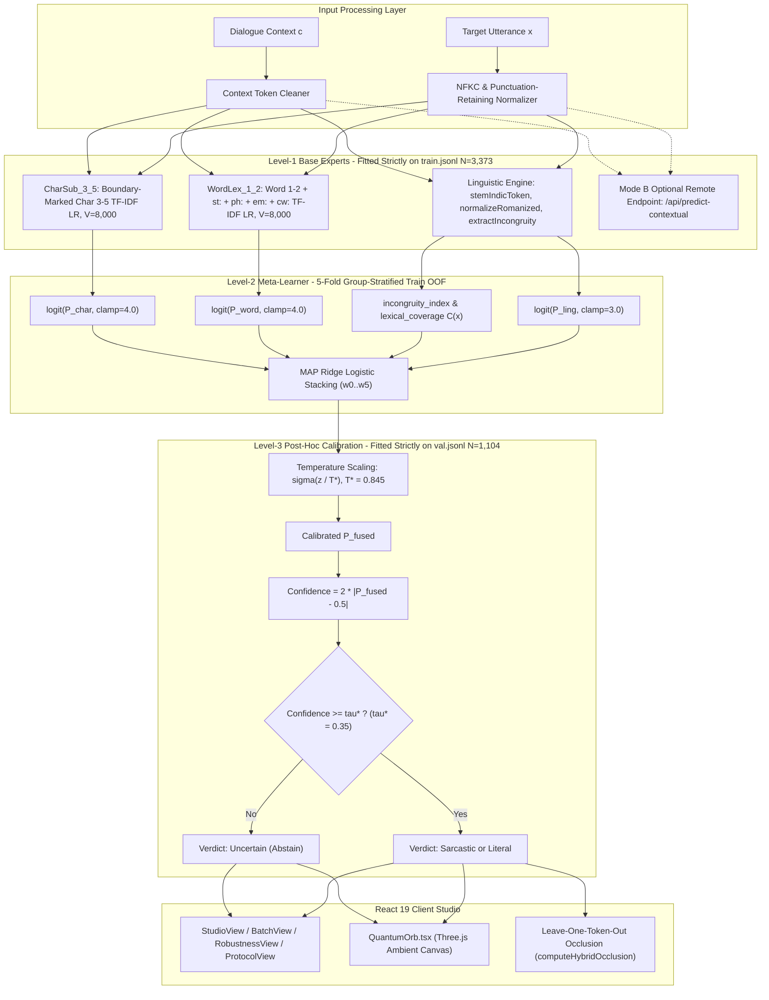

# SARcasmScope — Calibrated 3-Stage Feature-Fusion Architecture
**Project:** SARcasmScope: A Calibrated Feature-Fusion Framework for Context-Aware Sarcasm Detection in Multilingual and Code-Mixed Text  
**Principal Investigator:** Payal Mehta (`payal.12620246@vit.edu`)

---

## 1. System Overview

SARcasmScope is a client-side, deterministic, 3-stage stacked feature-fusion architecture (`src/engine/hybridFusion.ts`) implemented cleanly without runtime network dependencies. It combines a symbolic linguistic incongruity analyzer (`src/engine/sarcasmEngine.ts`), two Level-1 sparse linear experts (`WordLex_1_2` and `CharSub_3_5` in `src/engine/statisticalModel.ts` powered by shared extractors in `src/engine/textFeatures.ts`), a 5-fold group-stratified out-of-fold (OOF) MAP Ridge meta-learner, and post-hoc validation temperature scaling with selective risk gating (`T* = 0.845, tau* = 0.35` serialized in `src/engine/trainedModelData.ts`).

---

## 2. Exact Mathematical Formulation

### 2.1. Level-1 Symbolic Linguistic Incongruity Engine (`src/engine/sarcasmEngine.ts`)
For target utterance $x$ and optional context $c$:
$$\text{Idx}_{\text{incongruity}}(x, c) = 0.40 \cdot \text{Clash}_{\text{polarity}} + 0.35 \cdot \text{Clash}_{\text{context}} + 0.15 \cdot \min(\text{ContrastCount}, 2) + 0.10 \cdot \min(\text{IntensifierCount}, 2)$$
where `Clash_polarity` $\in \{0, 1\}$, `Clash_context` $\in \{0, 1\}$ when preceding context contains negative cues paired with positive praise, rhetorical patterns, or irony emojis in $x$. Lexical coverage density $C(x) = \min\left(1.0, \frac{\text{covered\_tokens}}{\max(1, \text{content\_tokens})}\right)$ counts tokens ($\ge 3$ chars) matching lexicon sets after raw, Devanagari/Telugu stemmed (`stemIndicToken`), and Romanized phonetic-folded (`normalizeRomanized`) views.

### 2.2. Level-1 Sparse Statistical Experts (`src/engine/textFeatures.ts` & `src/engine/statisticalModel.ts`)
- **`WordLex_1_2` ($V = 8,000$):** Sublinear L2-normalized TF-IDF $(1 + \ln \text{tf}) \cdot \text{idf}$ over utterance unigrams, Indic stems (`st:`), Romanized phonetic keys (`ph:`), emoji tokens (`em:`), utterance bigrams (`bg:`), and context unigrams/stems (`cw:`, `cw_st:`), trained via full-batch Adam ($\text{epochs}=70, \text{lr}=0.05, L_2=10^{-4}$).
- **`CharSub_3_5` ($V = 8,000$):** Sublinear L2-normalized TF-IDF over boundary-marked character 3–5 grams across truncated utterance and context, trained via full-batch Adam ($\text{epochs}=70, \text{lr}=0.05, L_2=2 \times 10^{-4}$).

### 2.3. Level-2 Out-of-Fold MAP Ridge Meta-Learner (`eval/train_and_calibrate.ts`)
Fitted strictly on 5-fold group-stratified `train.jsonl` OOF probabilities (grouped by `dataset__conversation_id`) with Gaussian prior $\mathcal{N}(\boldsymbol{\mu}_{\text{prior}}, \lambda^{-1}I)$, $\boldsymbol{\mu}_{\text{prior}} = [0.5, 0.5, 0.4, 0.2, 0.2]$, $\lambda_{\text{MAP}} = 0.25$:
$$z_{\text{raw}}(x, c) = w_0 + w_1 \cdot \text{logit}(P_{\text{word}}, 4) + w_2 \cdot \text{logit}(P_{\text{char}}, 4) + w_3 \cdot \text{logit}(P_{\text{ling}}, 3) + w_4 \cdot \text{Idx}_{\text{incongruity}} + w_5 \cdot C(x)$$
Fitted weights (`trainedModelData.ts`, `v2.0.0-oof-calibrated`, `405.36 KB`, **16,006 parameters** total):
$$w_0 = 0.3483, \quad w_1 = 0.54817, \quad w_2 = 0.54648, \quad w_3 = 0.26486, \quad w_4 = 0.19418, \quad w_5 = 0.20441$$

### 2.4. Level-3 Validation Temperature Scaling & Selective Prediction
Minimizing Negative Log-Likelihood on `val.jsonl` ($N = 1,104$) yields scalar temperature $T^* = 0.845$ (lowering validation NLL from $0.5798$ to $0.5777$ and held-out test Conf-ECE from $2.28\%$ to $1.36\%$):
$$P_{\text{fused}}(Y = 1 \mid x, c) = \sigma\left(\frac{z_{\text{raw}}}{T^*}\right) = \frac{1}{1 + \exp\left(-z_{\text{raw}} / T^*\right)}$$
Margin confidence gates selective prediction (Geifman & El-Yaniv, 2017) with validation-selected default $\tau^* = 0.35$:
$$\text{Confidence}(x, c) = 2 \cdot |P_{\text{fused}} - 0.50|, \qquad \text{Verdict} = \begin{cases} \text{Uncertain (Abstain)} & \text{if } \text{Confidence}(x, c) < \tau^* \\ \text{Sarcastic} & \text{if } P_{\text{fused}} \ge 0.50 \\ \text{Literal} & \text{otherwise} \end{cases}$$

---

## 3. Tiered Deployment Architecture (`src/engine/contextualEngine.ts`)

1. **Mode A (Standalone Client-Side — Default):**
   - 100% browser-local execution with zero external API calls (`405.36 KB` TypeScript model artifact).
   - Measured Node CPU latency: **`1.632 ms` mean, `1.423 ms` median, `2.856 ms` P95, `4.774 ms` P99** (`70.53 MB` Node heap).
2. **Mode B (Hybrid Cloud API Extension):**
   - Optional async POST to `/api/predict-contextual` with a `1,500 ms` `AbortController` timeout, fusing external transformer probabilities via `externalSemantic.p_transformer` (`predictHybrid`) and gracefully falling back to Mode A if offline or unconfigured.
