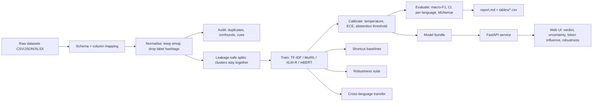

# Architecture

## Design decisions

* **Clusters, not rows, are split.** Exact duplicates, near-duplicates (character 4-gram MinHash/LSH, Jaccard >= 0.7)
  and optional conversation/user groups are merged into clusters; a greedy stratified assignment places whole clusters.
* **Normalisation preserves cues.** Emoji, `!!!`, `...` and ZWJ/ZWNJ are kept; label hashtags are removed.
* **Calibration without peeking.** On the validation split, temperature is cross-fitted (fit on one half, applied to the
  other). In the final run, temperature and threshold are fitted on validation and applied to test.
* **Test-set lock.** `--final` evaluates the test split once and writes `FINAL_LOCK.json`.
* **Plain PyTorch loop.** Avoids Trainer API changes between `transformers` versions.
* **Honest demo.** Without a bundle the app uses a toy-trained model and shows a banner.

## Extension points

* New dataset: add a `files:` entry with a `mapping:`.
* New model: implement `fit(texts, y, **kw)` and `predict_proba(texts, contexts=None) -> (n, 2)`; register it in `models/registry.py`.
* New perturbation: add a function to `eval/robustness.py::PERTURBATIONS`.
* Context experiments: pass `contexts` (previous turns) to `TransformerClassifier(use_context=True)`.
